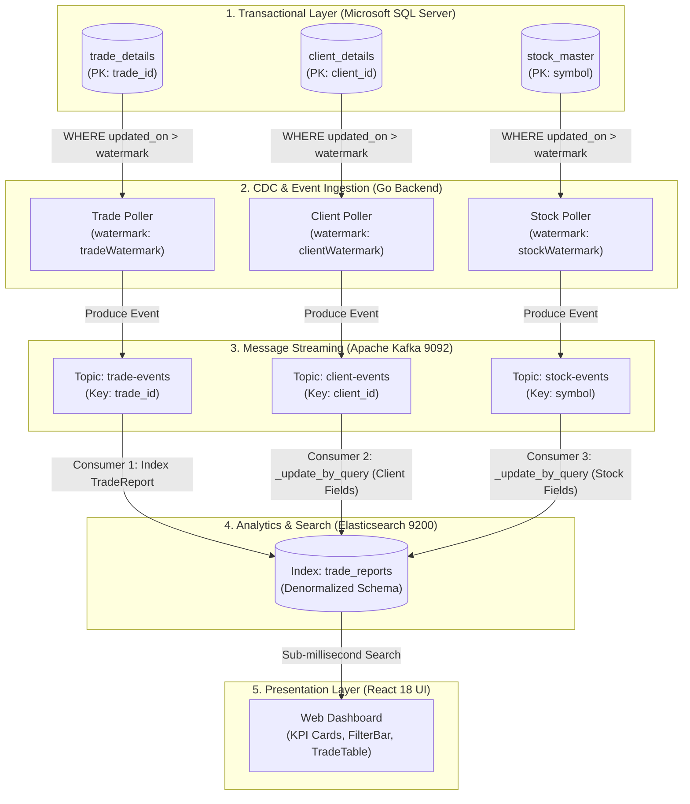

# TradeFlow: Comprehensive Architecture & Working Flow

This document provides the definitive architectural blueprint, data flow diagrams, change data capture (CDC) specifications, and operational workflows for the **TradeFlow Financial Trading & Real-Time Reporting Platform**.

---

## 1. System Overview & Problem Solved

### The Core Problem in Financial Systems
Traditional trading and reporting systems face a fundamental architectural tension:
- **OLTP (Online Transaction Processing)** requires ultra-fast, ACID-compliant relational databases (like Microsoft SQL Server) optimized for row-level inserts, updates, and locking.
- **Reporting & Analytics** requires fast multi-dimensional searches, ad-hoc filters, aggregations, substring lookups, and pagination across millions of trade records without impacting database transaction throughput.

Executing heavy analytical queries with joins directly against production transactional tables degrades database performance and causes lock contention.

### The TradeFlow Solution
TradeFlow decouples transactional execution from analytical reporting using a real-time event-driven streaming pipeline:
1. **MS SQL Server (`TradeDB`)**: Acts strictly as the transactional source of truth (clean domain tables with natural business columns only).
2. **Go CDC Engine**: Automatically polls for row-level modifications using high-watermark timestamps without requiring extra sync flags, tracking tables, or triggers.
3. **Apache Kafka (KRaft)**: Acts as the durable, distributed message broker streaming keyed domain events (`trade-events`, `client-events`, `stock-events`).
4. **Elasticsearch 9.5.7**: Stores pre-joined, denormalized `trade_reports` documents optimized for instant substring search, boolean filtering, and pagination.
5. **React Dashboard**: Provides a responsive, institutional user interface with real-time KPI metrics, fixed header scrolling, and auto-refresh.

---

## 2. End-to-End Pipeline Architecture



---

## 3. Multi-Table Change Data Capture (CDC) Mechanics

### Zero Extra Columns Constraint
Domain tables preserve their standard database schema:
- `trade_details`: `trade_id`, `order_id`, `client_id`, `symbol`, `exchange`, `segment`, `trade_type`, `quantity`, `price`, `trade_value`, `brokerage`, `taxes_charges`, `net_amount`, `trade_status`, `trade_time`, `updated_on`.
- `client_details`: `client_id`, `client_code`, `first_name`, `last_name`, `email`, `phone_number`, `pan_number`, `account_type`, `risk_category`, `status`, `address`, `created_at`, `updated_on`.
- `stock_master`: `symbol`, `company_name`, `isin_code`, `series`, `exchange`, `sector`, `face_value`, `lot_size`, `tick_size`, `currency`, `is_active`, `created_at`, `updated_on`.

### High-Watermark Delta Sync Algorithm
Each domain table operates on its own dedicated high-watermark timestamp in memory:

```go
// Initialized at startup directly from current DB max timestamps
tradeWatermark, _  := database.GetMaxTradeUpdatedOn()
clientWatermark, _ := database.GetMaxClientUpdatedOn()
stockWatermark, _  := database.GetMaxStockUpdatedOn()
```

#### Why Startup High-Watermarking Matters:
- When the backend starts up, `watermark` matches the newest record in the database.
- As a result, **zero existing records are re-streamed to Kafka** on launch.
- When an update occurs (e.g. `UPDATE client_details SET first_name = 'Ravi', updated_on = GETDATE() WHERE client_id = 'CL1001'`), only `CL1001` has `updated_on > clientWatermark`.
- **Only that single changed record is produced to Kafka and updated in Elasticsearch.**
- The watermark advances to the newest timestamp, preventing duplicate dispatches.

---

## 4. Kafka Topic Topology & Event Routing

| Topic Name | Partition Key | Event Type | Payload Model | Elasticsearch Action |
| :--- | :--- | :--- | :--- | :--- |
| `trade-events` | `trade_id` | `TRADE_UPDATED` | `models.TradeReport` | Upserts trade document via `PUT /trade_reports/_doc/{trade_id}` |
| `client-events` | `client_id` | `CLIENT_UPDATED` | `models.Client` | Updates `first_name`, `last_name`, `client_code`, `account_type` across all documents matching `client_id` via `_update_by_query` |
| `stock-events` | `symbol` | `STOCK_UPDATED` | `models.Stock` | Updates `company_name`, `sector`, `exchange` across all documents matching `symbol` via `_update_by_query` |

### In-Memory Stream Enrichment
When Kafka consumers process `trade-events`:
1. The consumer checks if client or stock metadata is already present in the message.
2. If absent, the consumer looks up reference details from `clientCache` and `stockCache` (thread-safe in-memory sync maps populated on startup and updated in real-time by `client-events` and `stock-events`).
3. This ensures every trade document indexed into Elasticsearch is fully enriched with client and company names.

---

## 5. Elasticsearch Denormalization & Query Optimization

### Mapping Schema (`trade_reports`)
- **`keyword` fields**: `trade_id`, `order_id`, `client_id`, `client_code`, `symbol`, `sector`, `exchange`, `segment`, `trade_type`, `trade_status`.
- **`text` fields**: `first_name`, `last_name`, `company_name`.
- **`numeric` / `date` fields**: `quantity`, `price`, `trade_value`, `brokerage`, `taxes_charges`, `net_amount`, `trade_time`, `indexed_at`.

### Query Execution Rules
1. **Identifiers & Codes (Keyword Fields)**:
   - Evaluated using `wildcard` queries with `case_insensitive: true` (e.g., `*TRD*`, `*rel*`, `*CL1001*`).
2. **Names & Company Descriptions (Text Fields)**:
   - Evaluated using `match_phrase_prefix`, `match`, and `query_string` wildcard analysis.
   - **Crucial Rule**: `case_insensitive: true` must **never** be used on `text` fields, as Elasticsearch will reject the request with HTTP 400.
3. **Pagination & Sorting**:
   - `from = (page - 1) * limit`, `size = limit`.
   - Dynamic sorting on `trade_time`, `price`, `quantity`, or `trade_value` in `asc` or `desc` order.

---

## 6. REST API Specification

### 1. Health Check
- **`GET /api/health`**
- **Response**: Connection health of MSSQL, Kafka, and Elasticsearch.

### 2. Authentication
- **`POST /api/login`**
- **Payload**: `{"username": "admin", "password": "admin123"}`
- **Response**: JWT session token and user profile.

### 3. Trade Reports (Strictly Elasticsearch)
- **`GET /api/reports/trades`**
- **Query Parameters**:
  - `search`: Substring search string (Trade ID, Client, Stock, Company Name).
  - `client_id`: Exact client ID filter (e.g. `CL1001`).
  - `symbol`: Exact stock symbol filter (e.g. `RELIANCE`).
  - `trade_type`: `ALL`, `BUY`, or `SELL`.
  - `sort_by`: `trade_time` (default), `trade_id`, `price`, `trade_value`, `quantity`.
  - `order`: `desc` or `asc`.
  - `page`: Page number (1-based index).
  - `limit`: Records per page (`50`, `100`, `250`, `500`, `1200`).

### 4. Live Trade Execution (OLTP ➔ Kafka ➔ Elastic)
- **`POST /api/trades`**
- **Payload**:
  ```json
  {
    "client_id": "CL1001",
    "symbol": "RELIANCE",
    "trade_type": "BUY",
    "quantity": 100,
    "price": 2950.00
  }
  ```

---

## 7. Operator Runbook: Setup, Startup & Verification

### Prerequisites
- Windows 10/11
- Microsoft SQL Server (`LAPTOP-OV8LM74T\MSSQLSERVERANIL`)
- Apache Kafka 3.x / 4.x (KRaft mode)
- Elasticsearch 9.5.7 (`http://localhost:9200`)
- Go 1.22+
- Node.js 18+

### Step-by-Step Startup

1. **Start Apache Kafka (KRaft mode)**:
   ```powershell
   cd D:\TradeProject\kafka
   .\bin\windows\kafka-server-start.bat .\config\kraft\server.properties
   ```
2. **Start Elasticsearch 9.5.7**:
   ```powershell
   cd D:\TradeProject\elasticsearch-9.5.7-windows-x86_64\elasticsearch-9.5.7
   .\bin\elasticsearch.bat
   ```
3. **Start Go Backend**:
   ```powershell
   cd D:\TradeProject\backend
   .\trade-backend.exe
   ```
4. **Start React Frontend**:
   ```powershell
   cd D:\TradeProject\frontend
   npm run dev
   ```

### Verification Scenarios

#### Scenario 1: Multi-Table Delta Sync
1. In SQL Server Management Studio (SSMS), execute:
   ```sql
   UPDATE client_details 
   SET updated_on = GETDATE(), first_name = 'Ravi' 
   WHERE client_id = 'CL1001';
   ```
2. Check the Go backend console. Within 3 seconds, you will see:
   ```
   [REALTIME CDC] ⚡ CLIENT TABLE UPDATE DETECTED: 1 record(s)
   [REALTIME CDC] 🔄 Client: CL1001 | Code: ALOK001 | Name: Ravi Sharma
   [Kafka Producer] 📤 Streamed CLIENT_UPDATED to topic 'client-events' (Key: CL1001)
   [REALTIME CDC] 🚀 Elasticsearch synced client CL1001 ('Ravi Sharma') across 401 trade report(s)!
   ```
3. In the browser (`http://localhost:5173/`), all trades for `CL1001` immediately display `Ravi Sharma`.

#### Scenario 2: Search Verification
1. Type `Ravi` in the search input and click the **Search** button (or press `Enter`).
2. The UI instantly returns the 401 records belonging to client Ravi.
3. Type `trd` in the search input. Case-insensitive wildcard queries return all matching trade IDs without errors.
