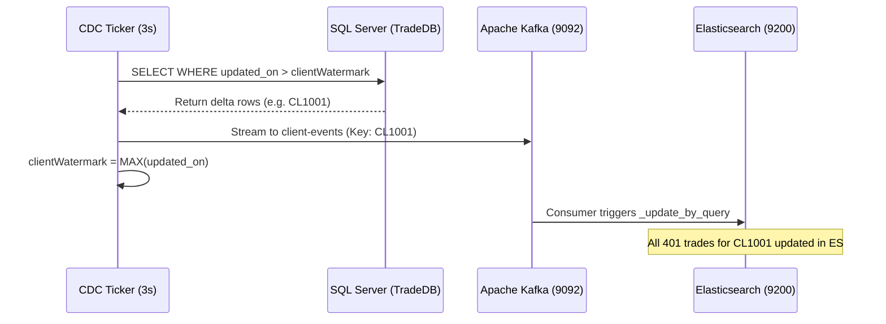

# TradeFlow Backend Service

High-performance, event-driven Go backend powering real-time financial trade capture, multi-table Change Data Capture (CDC), Kafka event streaming, Elasticsearch 9.5.7 analytics indexing, and REST APIs for institutional trading dashboards.

---

## 1. Architectural Highlights

- **Language & Runtime**: Go (Golang 1.23+) with native concurrency using goroutines and sync primitives.
- **Transactional OLTP**: Microsoft SQL Server (`TradeDB` on instance `LAPTOP-OV8LM74T\MSSQLSERVERANIL`) using Windows Authentication (`trusted_connection=yes`).
- **Zero-Pollution CDC Engine**: Captures row-level modifications across `trade_details`, `client_details`, and `stock_master` without adding triggers, shadow tables, or boolean sync flags to domain tables.
- **High-Watermark Delta Sync**: On startup, watermarks initialize to `MAX(ISNULL(updated_on, created_at))`. Only records modified *after* backend start are produced to Kafka.
- **Message Broker**: Apache Kafka 4.x (KRaft mode, port 9092) streaming keyed events across `trade-events`, `client-events`, and `stock-events`.
- **Search & Analytics Engine**: Elasticsearch 9.5.7 (port 9200) storing denormalized `trade_reports` documents with sub-millisecond multi-field filtering and keyword wildcard search.
- **REST API**: HTTP API serving the React trading frontend with pagination, dynamic KPI aggregations, and master data endpoints.

---

## 2. Directory Structure

```
backend/
├── cmd/
│   └── sync/
│       └── main.go           # CLI tool for full historical initial sync (MSSQL -> ES)
├── database/
│   └── mssql.go              # SQL Server connector, queries, delta pollers, watermarks
├── elastic/
│   └── client.go             # ES 9.5.7 client, index mappings, search queries, bulk updates
├── handlers/
│   └── handlers.go           # HTTP REST API handlers (Auth, Trades, KPI, Clients, Stocks)
├── kafka/
│   ├── admin.go              # Auto-creation of topics (trade-events, client-events, etc.)
│   ├── consumer.go           # Multi-topic consumers with thread-safe reference caches
│   └── producer.go           # Keyed event producers for trade, client, and stock deltas
├── models/
│   └── models.go             # Data structures (Trade, Client, Stock, TradeReport, Filters)
├── .env                      # Local runtime environment configuration
├── go.mod                    # Go module dependencies
├── go.sum                    # Dependency checksums
├── main.go                   # Backend entrypoint, CDC ticker goroutines, HTTP server
└── trade-backend.exe         # Compiled standalone Windows binary
```

---

## 3. Environment Configuration (`.env`)

```properties
# HTTP Server
PORT=8080

# Microsoft SQL Server
MSSQL_SERVER=LAPTOP-OV8LM74T\MSSQLSERVERANIL
MSSQL_DATABASE=TradeDB
# Leave empty for Windows Authentication (Trusted Connection):
MSSQL_USER=
MSSQL_PASSWORD=
MSSQL_ENCRYPT=disable

# Apache Kafka
KAFKA_BROKERS=localhost:9092
KAFKA_TOPIC=trade-events
KAFKA_GROUP_ID=trade-reporting-group

# Elasticsearch
ELASTICSEARCH_URL=http://localhost:9200
ELASTICSEARCH_INDEX=trade_reports

# Authentication & Security
AUTH_USERNAME=admin
AUTH_PASSWORD=admin123
AUTH_JWT_SECRET=super_secure_trade_secret_key_2026
```

---

## 4. Multi-Table Change Data Capture (CDC) Mechanics

### High-Watermark Algorithm

To prevent re-streaming all existing records on every backend restart, the CDC engine reads the maximum modification timestamp directly from the database at startup:

```go
// database/mssql.go & main.go
tradeWatermark,  _ := database.GetMaxTradeUpdatedOn()
clientWatermark, _ := database.GetMaxClientUpdatedOn()
stockWatermark,  _ := database.GetMaxStockUpdatedOn()
```

Every 3 seconds, a background ticker checks each domain table independently:



### Table Change Routing

| Source Table | Watermark Column | Kafka Topic | Partition Key | Elasticsearch Action |
|:---|:---|:---|:---|:---|
| `trade_details` | `ISNULL(updated_on, trade_time)` | `trade-events` | `trade_id` | Document upsert (`POST /trade_reports/_doc/{id}`) |
| `client_details` | `ISNULL(updated_on, created_at)` | `client-events` | `client_id` | Scripted `_update_by_query` on client fields |
| `stock_master` | `ISNULL(updated_on, created_at)` | `stock-events` | `symbol` | Scripted `_update_by_query` on stock fields |

---

## 5. Elasticsearch 9.5.7 Query Architecture

### Keyword vs. Text Query Separation

Elasticsearch 9.x strictly rejects `case_insensitive: true` inside `wildcard` queries on analyzed `text` fields with an HTTP 400 error. The query builder in `elastic/client.go` separates fields:

```go
// For analyzed text fields (first_name, last_name, company_name):
// Match phrase prefix or query_string:
elasticQuery["match_phrase_prefix"] = map[string]interface{}{
    "company_name": term,
}

// For keyword fields (trade_id, client_code, symbol, exchange, sector):
// Wildcard with case_insensitive: true:
elasticQuery["wildcard"] = map[string]interface{}{
    "symbol": map[string]interface{}{
        "value":            "*" + term + "*",
        "case_insensitive": true,
    },
}
```

---

## 6. REST API Specification

### Authentication

#### `POST /api/login`
Authenticates user against `.env` credentials and returns a signed JWT.

- **Request Body**:
  ```json
  {
    "username": "admin",
    "password": "admin123"
  }
  ```
- **Response `200 OK`**:
  ```json
  {
    "token": "eyJhbGciOiJIUzI1NiIsInR5cCI6IkpXVCJ9...",
    "user": {
      "username": "admin",
      "role": "Trade Admin"
    }
  }
  ```

---

### Trade Reporting & Search

#### `GET /api/trades`
Queries Elasticsearch index `trade_reports` with compound filtering, substring search, sorting, and pagination.

- **Query Parameters**:
  - `search` (string): Multi-field substring search across `trade_id`, `client_code`, `symbol`, `first_name`, `last_name`, `company_name`, `exchange`, `sector`.
  - `trade_type` (string): `BUY` or `SELL`.
  - `status` (string): `EXECUTED`, `PENDING`, `REJECTED`, `CANCELLED`.
  - `exchange` (string): `NSE`, `BSE`, `MCX`, `NASDAQ`.
  - `sector` (string): Filter by stock sector.
  - `from_date` (string): ISO 8601 / RFC 3339 date string (`YYYY-MM-DDTHH:MM:SSZ`).
  - `to_date` (string): ISO 8601 / RFC 3339 date string.
  - `page` (int, default `1`): 1-based page number.
  - `page_size` (int, default `20`): Items per page.
  - `sort_by` (string, default `trade_time`): Field name to sort on.
  - `sort_order` (string, default `desc`): `asc` or `desc`.

- **Response `200 OK`**:
  ```json
  {
    "data": [
      {
        "trade_id": "TR10001",
        "order_id": "ORD5521",
        "client_id": "CL1001",
        "client_code": "ALOK001",
        "first_name": "Alok",
        "last_name": "Kumar",
        "symbol": "RELIANCE",
        "company_name": "Reliance Industries Ltd",
        "exchange": "NSE",
        "segment": "EQUITY",
        "trade_type": "BUY",
        "quantity": 100,
        "price": 2450.50,
        "trade_value": 245050.00,
        "net_amount": 245100.00,
        "trade_status": "EXECUTED",
        "trade_time": "2026-11-24T10:15:30Z"
      }
    ],
    "pagination": {
      "page": 1,
      "page_size": 20,
      "total_records": 1201,
      "total_pages": 61
    }
  }
  ```

---

#### `GET /api/trades/summary`
Returns real-time KPI aggregations computed dynamically by Elasticsearch based on active search/filters.

- **Response `200 OK`**:
  ```json
  {
    "total_trades": 1201,
    "buy_count": 620,
    "sell_count": 581,
    "total_turnover": 451829000.50,
    "total_brokerage": 451829.00,
    "total_net_amount": 452280829.50
  }
  ```

---

### Trade Execution & Master Data

#### `POST /api/trades`
Inserts a new trade into SQL Server `trade_details`, enriches it with client and stock metadata, and immediately publishes an event to Kafka topic `trade-events`.

- **Request Body**:
  ```json
  {
    "client_id": "CL1001",
    "symbol": "TCS",
    "exchange": "NSE",
    "segment": "EQUITY",
    "trade_type": "BUY",
    "quantity": 50,
    "price": 3890.00
  }
  ```
- **Response `201 Created`**:
  ```json
  {
    "trade_id": "TR10002",
    "order_id": "ORD9812",
    "trade_status": "EXECUTED",
    "net_amount": 194538.90
  }
  ```

#### `GET /api/clients`
Returns all active clients directly from SQL Server for dropdown selection in the UI.

#### `GET /api/stocks`
Returns all active tradeable symbols from SQL Server.

#### `GET /api/health`
Health check verifying connectivity to SQL Server, Kafka broker, and Elasticsearch.

---

## 7. Build and Run Commands

### Running Locally with Go CLI
```powershell
cd D:\TradeProject\backend
go run main.go
```

### Compiling Standalone Binary
```powershell
cd D:\TradeProject\backend
go build -o trade-backend.exe main.go
```

### Running the Pre-compiled Binary
```powershell
cd D:\TradeProject\backend
.\trade-backend.exe
```

### Initial Full Historical Sync
To re-index all historical records from SQL Server into Elasticsearch from scratch:
```powershell
cd D:\TradeProject\backend
go run cmd/sync/main.go
```

---

## 8. Verification & Test Scenarios

### Verifying Delta CDC in SQL Server
1. Update a client name in SSMS:
   ```sql
   UPDATE client_details 
   SET first_name = 'Ravi', updated_on = GETDATE() 
   WHERE client_id = 'CL1001';
   ```
2. Check backend console output:
   ```
   [REALTIME CDC] ⚡ CLIENT TABLE UPDATE DETECTED: 1 record(s)
   [REALTIME CDC] 🔄 Client: CL1001 | Code: ALOK001 | Name: Ravi Sharma
   [Kafka Producer] 📤 Streamed CLIENT_UPDATED to topic 'client-events' (Key: CL1001)
   [REALTIME CDC] 🚀 Elasticsearch synced client CL1001 ('Ravi Sharma') across 401 trade report(s)!
   ```
3. Verify that zero other trades or tables were touched.
